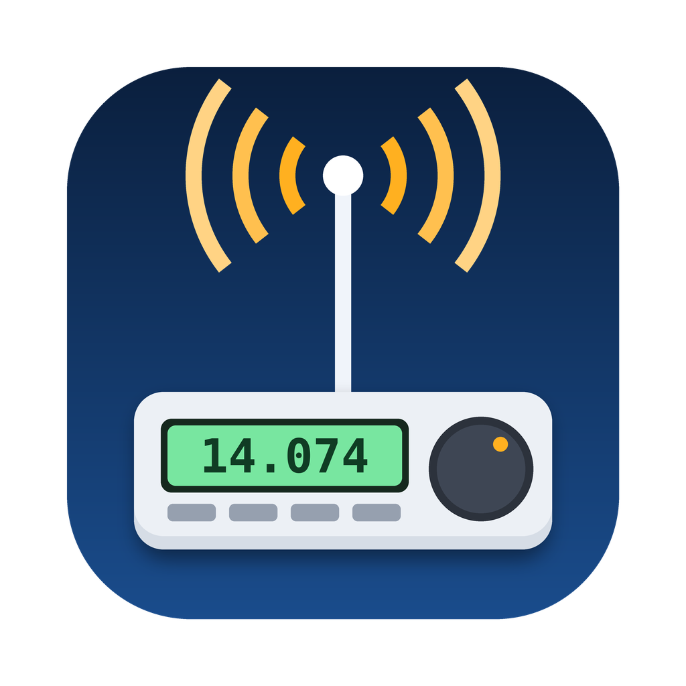
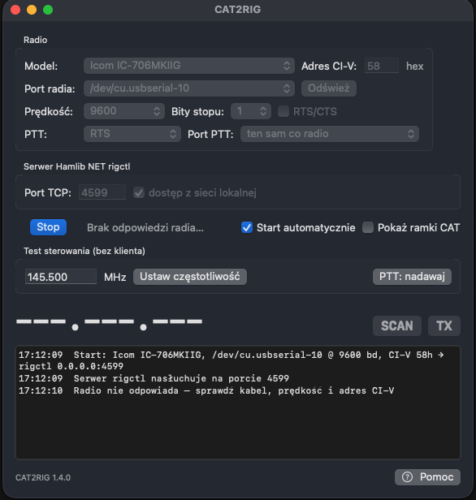

<p align="center">
  
</p>

<h1 align="center">CAT2RIG</h1>

<p align="center">
  Native macOS CAT bridge: <b>Icom · Yaesu · Kenwood · Elecraft · Xiegu · QRP Labs</b> → <b>Hamlib NET rigctl</b><br>
  Lets WSJT-X, JTDX, fldigi and loggers share one radio — like flrig or rigctld, but small and native.
</p>

<p align="center">
  <a href="README.pl.md">🇵🇱 Wersja polska</a> · <a href="https://github.com/SP5XTF/CAT2RIG/wiki">📖 Wiki</a>
</p>

<p align="center">
  <a href="https://github.com/SP5XTF/CAT2RIG/actions/workflows/ci.yml"></a>
  <a href="https://github.com/SP5XTF/CAT2RIG/releases/latest"></a>
  
  <a href="LICENSE"></a>
</p>

---



## Features

- **41 radio models** – Icom and Xiegu (CI-V), Yaesu (text and binary CAT), Kenwood, Elecraft, QRP Labs and (tr)uSDX; pick the model and the defaults are filled in
- **rigctld-compatible TCP server** – use *Hamlib NET rigctl* (model 2) in WSJT-X, JTDX, fldigi, loggers; several clients at once
- **PTT** by CAT command, or by RTS/DTR on the CAT port or a separate PTT port
- **DATA mode** (USB-D) on the IC-7300/705/7100/9700/7610 and Yaesu DATA-USB when the client asks for Data/Pkt
- Live frequency updates (Icom CI-V transceive), automatic memory → VFO switch on Icom
- **S-meter and power meter** – S1…S9+60 while receiving, output power while transmitting (Icom, Xiegu, Yaesu, FT-817 family, Hamlib); also available to clients as `l STRENGTH` / `l RFPOWER_METER`
- **SCAN indicator**, **control test** (set frequency / key PTT without a client), **log** of client commands and raw CAT frames
- **Hamlib included** – switch *Driver* to Hamlib for any of its 300+ radios, nothing to install (built-in drivers stay the default)
- **Auto-start**, **launch at macOS login**, built-in **help**, **English and Polish** UI
- Native SwiftUI app, no Python, Hamlib built in, 105 unit and integration tests

## Supported radios

| Maker | Model | Protocol | CI-V | Baud | CAT PTT | DATA | Hamlib # | Verified |
|---|---|---|---|---|---|---|---|---|
| Icom | IC-706MKIIG | CI-V | 58 | 19200 | – | – | 3011 | ✓ |
| Icom | IC-718 | CI-V | 5E | 9600 | – | – | 3013 |  |
| Icom | IC-746PRO | CI-V | 66 | 19200 | – | – | 3046 |  |
| Icom | IC-756PROIII | CI-V | 6E | 19200 | – | – | 3057 |  |
| Icom | IC-7000 | CI-V | 70 | 19200 | ✓ | – | 3060 |  |
| Icom | IC-7200 | CI-V | 76 | 19200 | ✓ | – | 3061 |  |
| Icom | IC-7410 | CI-V | 80 | 19200 | ✓ | – | 3067 |  |
| Icom | IC-7600 | CI-V | 7A | 19200 | ✓ | – | 3063 |  |
| Icom | IC-9100 | CI-V | 7C | 19200 | ✓ | – | 3068 |  |
| Icom | IC-7100 | CI-V | 88 | 19200 | ✓ | ✓ | 3070 |  |
| Icom | IC-7300 | CI-V | 94 | 19200 | ✓ | ✓ | 3073 |  |
| Icom | IC-705 | CI-V | A4 | 19200 | ✓ | ✓ | 3085 |  |
| Icom | IC-9700 | CI-V | A2 | 19200 | ✓ | ✓ | 3081 |  |
| Icom | IC-7610 | CI-V | 98 | 19200 | ✓ | ✓ | 3078 |  |
| Xiegu | G90 | CI-V | 88 | 19200 | ✓ | – | 3088 |  |
| Xiegu | X6100 | CI-V | 70 | 19200 | ✓ | – | 3087 |  |
| Xiegu | X5105 | CI-V | 70 | 19200 | ✓ | – | 3089 |  |
| Xiegu | X108G | CI-V | 70 | 19200 | – | – | 3076 |  |
| Yaesu | FT-991/991A | Yaesu text CAT |  | 38400 | ✓ | ✓ | 1035 |  |
| Yaesu | FT-891 | Yaesu text CAT |  | 38400 | ✓ | ✓ | 1036 |  |
| Yaesu | FT-710 | Yaesu text CAT |  | 38400 | ✓ | ✓ | 1049 |  |
| Yaesu | FTDX10 | Yaesu text CAT |  | 38400 | ✓ | ✓ | 1042 |  |
| Yaesu | FTDX101D/MP | Yaesu text CAT |  | 38400 | ✓ | ✓ | 1040 |  |
| Yaesu | FTDX5000 | Yaesu text CAT |  | 38400 | ✓ | ✓ | 1032 |  |
| Yaesu | FTDX3000 | Yaesu text CAT |  | 38400 | ✓ | ✓ | 1037 |  |
| Yaesu | FTDX1200 | Yaesu text CAT |  | 38400 | ✓ | ✓ | 1034 |  |
| Yaesu | FT-2000 | Yaesu text CAT |  | 38400 | ✓ | ✓ | 1029 |  |
| Yaesu | FT-950 | Yaesu text CAT |  | 38400 | ✓ | ✓ | 1028 |  |
| Yaesu | FT-450/450D | Yaesu text CAT |  | 38400 | ✓ | ✓ | 1046 |  |
| Yaesu | FT-817/818 | Yaesu binary CAT |  | 4800 | ✓ | – | 1020 |  |
| Yaesu | FT-857/857D | Yaesu binary CAT |  | 4800 | ✓ | – | 1022 |  |
| Yaesu | FT-897/897D | Yaesu binary CAT |  | 4800 | ✓ | – | 1023 |  |
| Kenwood | TS-590S/SG | Kenwood CAT |  | 115200 | ✓ | – | 2031 |  |
| Kenwood | TS-480 | Kenwood CAT |  | 57600 | ✓ | – | 2028 |  |
| Kenwood | TS-2000 | Kenwood CAT |  | 57600 | ✓ | – | 2014 |  |
| Elecraft | K2 | Kenwood CAT |  | 4800 | ✓ | – | 2021 |  |
| Elecraft | K3/K3S | Kenwood CAT |  | 38400 | ✓ | – | 2029 |  |
| Elecraft | KX2/KX3 | Kenwood CAT |  | 38400 | ✓ | – | 2045 |  |
| Elecraft | K4 | Kenwood CAT |  | 38400 | ✓ | – | 2047 |  |
| QRP Labs | QDX/QCX/QMX | Kenwood CAT |  | 9600 | ✓ | – | 2052 |  |
| DL2MAN | (tr)uSDX | Kenwood CAT |  | 38400 | ✓ | – | 2055 |  |

**Verified** = tested on a real radio; the others were tested with protocol simulators. CI-V addresses and baud rates are factory defaults – check your radio's menu. *Hamlib #* is the model number in `rigctl -l`. Reports from owners are very welcome – [open an issue](https://github.com/SP5XTF/CAT2RIG/issues/new/choose) with the CAT frames log.

### Other radios via Hamlib

Set **Driver: Hamlib** and pick any model from the menu (grouped by manufacturer, with the Hamlib model number). The *Hamlib Dummy* model is a simulator for testing WSJT-X without a radio.

## Requirements

- macOS 13 Ventura or newer (Apple Silicon or Intel)
- A supported radio with its CAT/USB cable or interface
- To build from source: Xcode 15+ (or Command Line Tools for building only; tests need full Xcode)

## Installation

### Download

Grab `CAT2RIG-X.Y.dmg` from [Releases](https://github.com/SP5XTF/CAT2RIG/releases), open it and drag **CAT2RIG** to **Applications** (a `.zip` is available too).

The app is not notarized by Apple, so the first launch is blocked by Gatekeeper. Either right-click the app → **Open** → **Open**, or run:

```bash
xattr -dr com.apple.quarantine /Applications/CAT2RIG.app
```

### Build from source

```bash
git clone https://github.com/SP5XTF/CAT2RIG.git
cd CAT2RIG
bash build_app.sh          # CAT2RIG.app (first run also builds Hamlib, a few minutes)
bash build_dmg.sh          # CAT2RIG-X.Y.dmg
```

### Upgrading from Civ2Rig

CAT2RIG is the new name of Civ2Rig (≤ 1.2). Settings are migrated automatically on first launch. If you used *Launch at login* in Civ2Rig, turn it off there first, delete Civ2Rig.app and enable the option again in CAT2RIG.

## Setup

1. **Model** – choose your radio; baud rate, stop bits, RTS/CTS, CI-V address and PTT are set to defaults.
2. **Radio port** – the CAT port of your interface or USB cable (`/dev/cu.…`). Match the **baud rate** to the radio's menu.
3. **PTT** – *CAT* where supported, *RTS/DTR* if your interface keys the transmitter with a line.
4. **Start** – “Radio connected” and a frequency on the display mean CAT works.

Radio-specific notes:

- **Icom / Xiegu** – CI-V address must match the radio's menu; enable *CI-V Transceive* for instant knob updates.
- **Yaesu FT-991A, FT-891, FT-710, FTDX…** – set *CAT RATE* in the radio menu to the same baud rate. If *CAT RTS* is enabled in the radio, keep **RTS/CTS** ticked; if the radio stays silent, disable CAT RTS and untick RTS/CTS.
- **Yaesu FT-817/857/897** – 2 stop bits, CAT rate from the radio menu (4800 by default).
- **Kenwood / Elecraft** – Auto Information is switched off automatically.

**WSJT-X / JTDX → Settings → Radio:**

| Setting | Value |
|---|---|
| Rig | Hamlib NET rigctl |
| Network Server | `127.0.0.1:4532` (the TCP port from CAT2RIG) |
| PTT Method | CAT |
| Mode | USB, or Data/Pkt for radios with a DATA mode |
| Read and display PWR and SWR | **off** |

Start CAT2RIG first, then WSJT-X. Only CAT2RIG should open the CAT port.

## Troubleshooting

| Symptom | Cause / fix |
|---|---|
| “Radio not responding” | wrong model, baud rate, CI-V address or port; Yaesu: stop bits and RTS/CTS. Enable *Show CAT frames*: only `TX` → radio silent; no `RX` → wrong port or cable |
| Port busy | flrig or rigctld holds the port – close it |
| WSJT-X: *Connection refused* | CAT2RIG not running, or TCP port differs |
| WSJT-X: *cannot open PTT device* | WSJT-X and CAT2RIG both want the PTT port – set PTT Method = CAT in WSJT-X |
| Slow reaction | look for “Slow radio response” in the log |

Log codes: `RPRT 0` OK · `-1` bad argument · `-5` radio not responding · `-9` rejected by the radio · `-11` unsupported command.

## Supported rigctl commands

`f` `F` `m` `M` `t` `T` `v` `V` `s` `S` `q`, their long forms (`\get_freq`, `\set_freq`, …), `\dump_state` (protocol 1), `\chk_vfo`, `\get_powerstat`, `\get_lock_mode`, `\set_lock_mode`, `l STRENGTH`, `l RFPOWER_METER`. VFO arguments (`F VFOA 14074000`) and extended-response prefixes are accepted. Tested with Hamlib 4.5 and WSJT-X-improved with Hamlib 4.7.1.

## Project structure

```
Sources/CAT2RIGCore/   serial port, drivers (IcomRig, TextCatRig, YaesuBinaryRig), radio models,
                       HamlibRig, rigctl protocol and TCP server
Sources/CAT2RIG/       SwiftUI app: main window, help, settings
Tests/                 XCTest – simulated Icom, Yaesu, Kenwood and FT-817 radios + real TCP clients
Resources/             app icon, translations (pl = base language, en)
build_app.sh           builds and ad-hoc signs CAT2RIG.app
build_dmg.sh           packs it into a DMG
scripts/build_hamlib.sh  builds the bundled Hamlib library (universal)
```

Run the tests with `swift test` or ⌘U in Xcode.

## Adding a radio

Most radios only need a new entry in `RadioModel.all` (`Sources/CAT2RIGCore/RadioModels.swift`): protocol family, CI-V address, default baud rate, stop bits and whether CAT PTT works. Pull requests welcome.

## License

[MIT](LICENSE). Release builds include [Hamlib](https://github.com/Hamlib/Hamlib) (LGPL 2.1) as a separate, replaceable library – see [THIRD_PARTY_NOTICES.md](THIRD_PARTY_NOTICES.md).

73 de SP5XTF!
