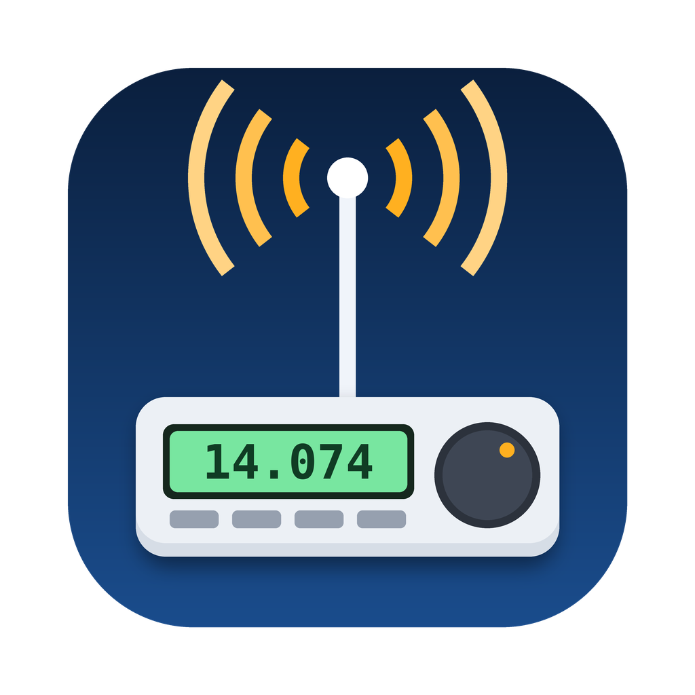
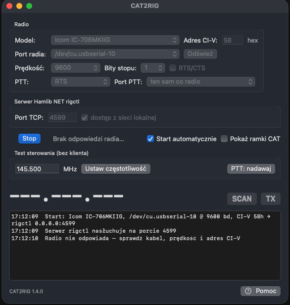

<p align="center">
  
</p>

<h1 align="center">CAT2RIG</h1>

<p align="center">
  Natywny most CAT dla macOS: <b>Icom · Yaesu · Kenwood · Elecraft · Xiegu</b> → <b>Hamlib NET rigctl</b><br>
  WSJT-X, JTDX, fldigi i loggery sterują jednym radiem jednocześnie – jak przez flrig albo rigctld, tylko lżej.
</p>

<p align="center">
  <a href="README.md">🇬🇧 English version</a> · <a href="../../wiki/PL-Strona-glowna">📖 Wiki</a>
</p>

<p align="center">
  <a href="https://github.com/<twoj-uzytkownik>/CAT2RIG/actions/workflows/ci.yml">/CAT2RIG/actions/workflows/ci.yml/badge.svg" alt="CI"></a>
  <a href="../../releases/latest">/CAT2RIG" alt="Wydanie"></a>
  
  <a href="LICENSE"></a>
</p>

---



## Możliwości

- **Wiele radiów** – Icom i Xiegu (CI-V), nowsze Yaesu (CAT tekstowy), Yaesu FT-817/857/897 (CAT binarny), Kenwood i Elecraft; wybierasz model, a ustawienia domyślne wypełniają się same
- **Serwer TCP zgodny z rigctld** – w WSJT-X, JTDX, fldigi i loggerach wybierasz *Hamlib NET rigctl* (model 2); wielu klientów naraz
- **PTT** komendą CAT albo linią RTS/DTR na porcie CAT lub osobnym porcie PTT
- **Tryb DATA** (USB-D) w IC-7300/705/7100/9700/7610 oraz DATA-USB w Yaesu, gdy klient wybierze Data/Pkt
- Zmiany częstotliwości na bieżąco (CI-V transceive), automatyczne przełączanie pamięć → VFO w Icomach
- **Wskaźnik SCAN**, **test sterowania** (częstotliwość i PTT bez programu klienckiego), **log** komend klientów i surowych ramek CAT
- **Autostart**, **uruchamianie przy logowaniu do macOS**, wbudowana **pomoc**, interfejs **po polsku i po angielsku**
- Natywna aplikacja SwiftUI – bez Pythona i bez instalowania Hamlib; 78 testów jednostkowych i integracyjnych

## Obsługiwane radia

| Producent | Modele | Protokół | PTT przez CAT |
|---|---|---|---|
| Icom | IC-706MKIIG, IC-718 | CI-V | – (RTS/DTR) |
| Icom | IC-7000, IC-7100, IC-7300, IC-705, IC-9700, IC-7610, inne CI-V | CI-V | ✓ |
| Xiegu | G90, X6100, X5105 | CI-V | ✓ |
| Yaesu | FT-991/991A, FT-891, FT-710, FTDX10, FTDX101, FT-950, FT-450D | CAT tekstowy | ✓ |
| Yaesu | FT-817/818, FT-857, FT-897 | CAT binarny (8N2) | ✓ |
| Kenwood | TS-590S/SG, TS-480, TS-2000 | CAT Kenwood | ✓ |
| Elecraft | K3/K3S, KX2/KX3, K4 | CAT Kenwood | ✓ |

Sprawdzone na prawdziwym radiu: IC-706MKIIG. Pozostałe sterowniki są przetestowane na symulatorach protokołów – zgłoszenia od właścicieli tych radiów są bardzo mile widziane (issue z logiem ramek CAT).

## Wymagania

- macOS 13 Ventura lub nowszy (Apple Silicon albo Intel)
- Obsługiwane radio z kablem/interfejsem CAT lub USB
- Do budowania ze źródeł: Xcode 15+ (do samego budowania wystarczą Command Line Tools; testy wymagają pełnego Xcode)

## Instalacja

### Pobranie gotowej aplikacji

Pobierz `CAT2RIG-X.Y.dmg` z zakładki [Releases](../../releases), otwórz go i przeciągnij **CAT2RIG** do **Programów** (dostępny jest też `.zip`).

Aplikacja nie jest notaryzowana przez Apple, więc przy pierwszym uruchomieniu zablokuje ją Gatekeeper. Kliknij aplikację prawym przyciskiem → **Otwórz** → **Otwórz** albo wykonaj:

```bash
xattr -dr com.apple.quarantine /Applications/CAT2RIG.app
```

### Budowanie ze źródeł

```bash
git clone https://github.com/<twoj-uzytkownik>/CAT2RIG.git
cd CAT2RIG
bash build_app.sh          # CAT2RIG.app
bash build_dmg.sh          # CAT2RIG-X.Y.dmg
```

### Aktualizacja z Civ2Rig

CAT2RIG to nowa nazwa programu Civ2Rig (≤ 1.2). Ustawienia przenoszą się same przy pierwszym uruchomieniu. Jeśli w Civ2Rig było włączone *Uruchamiaj przy logowaniu*, najpierw wyłącz to w starej aplikacji, usuń Civ2Rig.app i włącz opcję ponownie w CAT2RIG.

## Konfiguracja

1. **Model** – wybierz radio; prędkość, bity stopu, RTS/CTS, adres CI-V i PTT ustawią się na wartości domyślne.
2. **Port radia** – port CAT interfejsu lub kabla USB (`/dev/cu.…`). **Prędkość** ustaw taką jak w menu radia.
3. **PTT** – *CAT*, jeśli radio to obsługuje; *RTS/DTR*, gdy interfejs kluczuje nadajnik linią.
4. **Start** – „Radio połączone” i częstotliwość na wyświetlaczu oznaczają, że CAT działa.

Uwagi dla poszczególnych radiów:

- **Icom / Xiegu** – adres CI-V musi być taki jak w menu radia; włącz *CI-V Transceive*, żeby zmiany z gałki były widoczne od razu.
- **Yaesu FT-991A, FT-891, FT-710, FTDX…** – w menu radia ustaw *CAT RATE* na tę samą prędkość. Jeśli w radiu jest włączone *CAT RTS*, zostaw zaznaczone **RTS/CTS**; gdy radio nie odpowiada, wyłącz CAT RTS i odznacz RTS/CTS.
- **Yaesu FT-817/857/897** – 2 bity stopu, prędkość CAT z menu radia (domyślnie 4800).
- **Kenwood / Elecraft** – Auto Information jest wyłączane automatycznie.

**WSJT-X / JTDX → Settings → Radio:**

| Ustawienie | Wartość |
|---|---|
| Rig | Hamlib NET rigctl |
| Network Server | `127.0.0.1:4532` (port TCP z CAT2RIG) |
| PTT Method | CAT |
| Mode | USB albo Data/Pkt (radia z trybem DATA) |
| Read and display PWR and SWR | **wyłączone** |

Najpierw uruchamiaj CAT2RIG, potem WSJT-X. Port CAT otwiera tylko CAT2RIG.

## Rozwiązywanie problemów

| Objaw | Przyczyna / rozwiązanie |
|---|---|
| „Radio nie odpowiada” | zły model, prędkość, adres CI-V albo port; Yaesu: bity stopu i RTS/CTS. Włącz *Pokaż ramki CAT*: tylko `TX` → radio milczy; brak `RX` → zły port lub kabel |
| Port zajęty | port trzyma flrig albo rigctld – zamknij go |
| WSJT-X: *Connection refused* | CAT2RIG nie działa albo port TCP się różni |
| WSJT-X: *cannot open PTT device* | WSJT-X i CAT2RIG chcą tego samego portu PTT – w WSJT-X ustaw PTT Method = CAT |
| Wolna reakcja | szukaj w logu wpisów „Wolna odpowiedź radia” |

Kody w logu: `RPRT 0` OK · `-1` zły argument · `-5` radio nie odpowiada · `-9` radio odrzuciło komendę · `-11` komenda nieobsługiwana.

## Obsługiwane komendy rigctl

`f` `F` `m` `M` `t` `T` `v` `V` `s` `S` `q`, ich długie formy (`\get_freq`, `\set_freq`, …), `\dump_state` (protokół 1), `\chk_vfo`, `\get_powerstat`, `\get_lock_mode`, `\set_lock_mode`. Akceptowane są argumenty VFO (`F VFOA 14074000`) i prefiksy trybu rozszerzonego. Sprawdzone z Hamlib 4.5 oraz WSJT-X-improved z Hamlib 4.7.1.

## Struktura projektu

```
Sources/CAT2RIGCore/   port szeregowy, sterowniki (IcomRig, TextCatRig, YaesuBinaryRig), modele radiów,
                       protokół i serwer rigctl
Sources/CAT2RIG/       aplikacja SwiftUI: okno główne, pomoc, ustawienia
Tests/                 XCTest – symulowane radia Icom, Yaesu, Kenwood i FT-817 + prawdziwi klienci TCP
Resources/             ikona, tłumaczenia (pl = język bazowy, en)
build_app.sh           buduje i podpisuje (ad-hoc) CAT2RIG.app
build_dmg.sh           pakuje ją do obrazu DMG
```

Testy: `swift test` albo ⌘U w Xcode.

## Dodawanie radia

Zwykle wystarczy nowy wpis w `RadioModel.all` (`Sources/CAT2RIGCore/RadioModels.swift`): rodzina protokołu, adres CI-V, domyślna prędkość, bity stopu i to, czy działa PTT przez CAT. Pull requesty mile widziane.

## Licencja

[MIT](LICENSE)

73!
