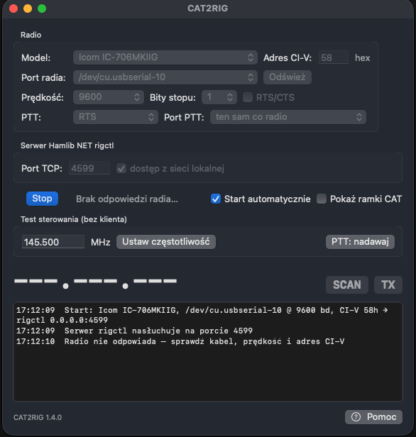

# Configuration

## Radio
| Field | Meaning |
|---|---|
| **Model** | your radio. Choosing it fills in baud rate, stop bits, RTS/CTS, CI-V address and PTT |
| **CI-V address** | Icom/Xiegu only, hex (e.g. `94`); must match the radio's menu |
| **Radio port** | the CAT port (`/dev/cu.…`). Use **Refresh** after plugging the cable in |
| **Baud rate** | must match the radio's CAT/CI-V baud rate |
| **Stop bits** | 1 or 2 (old Yaesu need 2; 2 works with most radios) |
| **RTS/CTS** | hardware flow control – for Yaesu radios with *CAT RTS* enabled |
| **PTT** | *CAT*, *RTS*, *DTR* or *none / VOX* – see below |
| **PTT port** | for RTS/DTR: the port whose line keys the transmitter (*same as radio* by default) |

## PTT
- **CAT** – a CAT command keys the radio. Available for every radio except the IC-706MKIIG and IC-718.
- **RTS / DTR** – an interface line keys the radio. The PTT port is opened non-exclusively, so another program may keep it open too.
- **none / VOX** – CAT2RIG doesn't touch PTT.

RTS/CTS and RTS-PTT on the same port can't be combined – CAT2RIG refuses to start in that case.

## rigctl server
| Field | Meaning |
|---|---|
| **TCP port** | 4532 is the standard rigctld port. Use another one if flrig/rigctld runs too |
| **Allow access from local network** | lets programs on other computers connect (macOS asks for permission) |

## Window
- **Display** – frequency and mode read from the radio; **TX** red while transmitting; **SCAN** orange on rapid frequency changes.
- **S / PO meter** – S-meter while receiving, output power (%) while transmitting, when the radio reports them (Icom/Xiegu, newer Yaesu, FT-817/857/897, Hamlib). “—” = no reading. Values are approximate.
- **Control test** – set a frequency or key PTT without any client (PTT really transmits!).
- **Log** – client set commands, unsupported commands, slow responses (≥ 300 ms). **Show CAT frames** adds raw traffic.
- **Start automatically** – connect on launch; waits for the USB interface (retries every 5 s).

## Settings (⌘,)
- **Launch at macOS login** – move the app to Applications first.
- **Program language** – System / Polski / English (restart needed).
